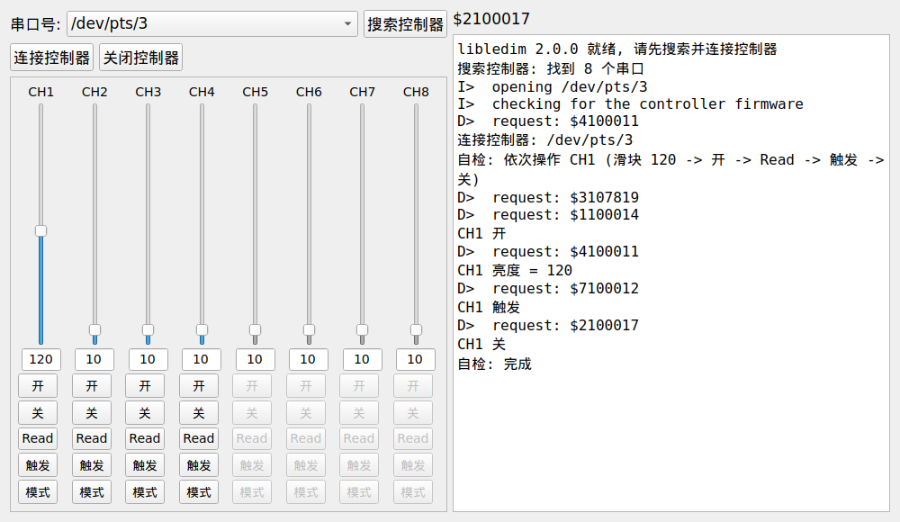
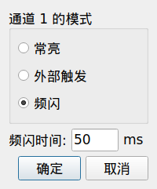

# libledim 重写版（v2.0.0）

这是光源（LED 光源控制器）控制库的一次重写，替代 `../LEDim/`（原工程 + Linux 移植版）。
代码注释是英文，与原工程保持一致；文档是中文。

## 一句话结论

对外接口一字不改：`libledim_*` 的函数名、参数、返回值、语义都和原来一致，C/C++/C# 调用方
不需要改动任何一行；换掉的只是内部实现——原来那套自研框架（`ycxy/adapt/cmake`，约 13000 行）
整个去掉了。

## 为什么要重写

这个库真正要做的事只有一件：打开串口，发 8 字节，收 1 或 8 字节。原实现里承担这件事的
业务代码不到 400 行，其余是上位机用不到的基础设施抽象（位域状态字、挂载/组合语义、
变长字符串链表、FIFO、四层日志）。移植时踩到的三个 bug——无界 `strcpy`、链表回收 use-after-free、
未初始化的 Win32 句柄——没有一个是业务逻辑的错，全都是这层抽象带来的。

## 结构

```
光源控制/（工程根目录，库就在这里）
├── libledim/                    库：源码 + 头文件 + 编出来的 .so
│   ├── include/libledim.h       唯一的公共头，自包含
│   ├── include/magic.h          兼容垫片（老代码 include 它也不会编不过）
│   ├── src/
│   │   ├── libledim_proto.{h,c}        协议层：纯函数，无 IO，无状态，可脱机单测
│   │   ├── libledim_transport.h        传输层接口（open/write/read/flush/close 的 vtable）
│   │   ├── libledim_transport_posix.c  termios 实现（Linux / macOS 等）
│   │   ├── libledim_transport_win32.c  comm API 实现（本机未编译验证，见"未验证的部分"）
│   │   ├── libledim_portscan.c         串口列表缓存 + 公共 Count/Peek 接口
│   │   ├── libledim_portscan_posix.c   /dev 枚举
│   │   ├── libledim_portscan_win32.c   注册表枚举（同上，未编译验证）
│   │   ├── libledim_log.{h,c}          一个回调、一个级别，就是全部日志
│   │   ├── libledim_device.{h,c}       设备层：一个 handle 一台控制器，无全局可变状态
│   │   └── libledim_compat.c           第一代接口的门面，全部转发到设备层
│   └── libledim.so*                    编出来的库
├── 命令行/libledim_cli.c               命令行工具 libledim-clidemo
├── 界面/                               图形界面 libledim-gui（Qt5 Widgets，可选）
│   └── screenshots/                    界面截图
├── 测试/                               协议单测 + 集成测试 + 差分测试
├── CMakeLists.txt                      工程文件
├── libledim-gui、libledim-clidemo      编出来的可执行文件（就在工程根目录）
└── 运行.sh、编译.sh、先看这个.md        中文入口（日常只看 先看这个.md）
```

分层的意义：协议层可以被固定向量离线验证；传输层可以被替换（测试用伪终端，将来要接
TCP 转发或模拟器也只是多一个 vtable 实现）；设备层让"同时控多台"变成一句话的事；兼容层
只负责把老接口接上。

## 编译与安装

```bash
cmake -S . -B build -DCMAKE_BUILD_TYPE=Release
cmake --build build -j
ctest --test-dir build --output-on-failure      # 四个测试
sudo cmake --install build                     # 想装到系统里时
```

产物：`libledim.so`（`libledim.so.2.0.0`，SONAME `libledim.so.2`）、静态库 `libledim.a`、
命令行工具 `libledim-clidemo`、图形界面 `libledim-gui`。安装后可用 pkg-config：

```bash
gcc app.c $(pkg-config --cflags --libs ledim)     # -I<inc>/libledim -L<lib> -lledim
#include <libledim.h>      或老写法  #include <magic.h>
```

图形界面需要 Qt5 Widgets（Debian/Ubuntu 上是 `qtbase5-dev`）；找不到时自动跳过，库本身照常构建。

## 图形界面



就是旧 SDK 那个 `PCSoftware.exe` 的界面，接在新的库上：

- 上行：串口号下拉框 + `搜索控制器` / `连接控制器` / `关闭控制器`
- 中间：8 路通道列，每列一个垂直滑块、亮度数值、`开` / `关` / `Read` / `触发` / `模式`
  ——**CH5~CH8 和旧版一样是灰的**，因为控制器只有 4 路
- 右侧：日志窗（旧版把 SDK 日志导进这个 RichEdit，新版把库的日志导进来），上方那条显示
  控制器收到的最后一帧请求（对应旧版那句"协议范文:$310381E"）
- 拖动滑块即时下发亮度：旧版靠 20ms 定时器轮询滑块位置，新版同样是 20ms 合流下发，手感一致
- `模式` 打开同形状的模态框：

```bash
libledim-gui                              # 打开后自己搜索/连接
libledim-gui -p /dev/ttyUSB0              # 打开即连接指定串口
libledim-gui -p /dev/ttyUSB0 --selfcheck  # 自动把 CH1 的按钮点一遍后退出（接线自查）
libledim-gui --screenshot win.png         # 离屏渲染成 png（配合 QT_QPA_PLATFORM=offscreen 无屏幕查布局）
```

与旧界面的差异只有三处，都是能力边界不同带来的：

1. 旧版 `模式` 框有"毫秒级频闪 / 微秒级频闪"两个选项，libledim 的频闪时长只有毫秒，所以这里
   给的是 `常亮 / 外部触发 / 频闪` 三选项 + 毫秒时间——多一个按不了的按钮不如不给。
2. 串口列表里是主机真实的设备名（`/dev/ttyUSB0`、`COM3`），不再是旧版写死的 `Com1..ComN`。
3. 失败信息带原因（"the controller refused the command"、"os error 13"），不再是一个数字。

## 两套接口

**第一代接口（照旧，一个进程一台控制器）**

```c
bool     libledim_Init (const char* arg_com_portname);   // NULL = 扫描本机
void     libledim_Deinit (void);
void     libledim_SetTransactionTimeout (uint32_t arg_timeout_ms);
bool     libledim_EndisChannel (uint8_t ch, bool tof);
uint8_t  libledim_GetChannelLuminanceLevel (uint8_t ch);
bool     libledim_SetChannelLuminanceLevel (uint8_t ch, uint8_t level);
bool     libledim_TriggerChannelFlash (uint8_t ch);
bool     libledim_SetChannelMode (uint8_t ch, uint8_t mode);          // 0 常亮 / 1 外部触发 / 2 频闪
bool     libledim_SetChannelFlashDuration (uint8_t ch, uint8_t ms);
const char* libledim_GetComPortname (void);
uint32_t    libledim_CountComPorts (void);               // 本机串口数量，无需先 Init
const char* libledim_PeekComPortByIdx (uint32_t idx);
```

**句柄接口（新增，可以同时控多台，各自独立的错误状态）**

```c
libledim_Device* dev = libledim_Device_Open ("/dev/ttyUSB0");   // NULL = 扫描本机
libledim_Device_EndisChannel (dev, 1, true);
libledim_Device_SetChannelLuminanceLevel (dev, 1, 200);
libledim_Device_Close (dev);
```

**错误与日志（新增，纯增量）**

```c
libledim_Error libledim_Device_GetLastError (const libledim_Device* dev);
const char*    libledim_Device_GetLastErrorString (const libledim_Device* dev);
int            libledim_Device_GetLastOsError (const libledim_Device* dev);  // errno / GetLastError()
// 第一代接口也有对应的 libledim_GetLastError() / _String() / _OsError()

libledim_SetLogCallback (libledim_LogToStderr);            // 不设回调，库就一声不吭
libledim_SetMinLogLevel (libledim_LogLevel_Debug);
```

Debug 级别下每一笔事务都会先打印它要发的帧（`D>  request: $330C86F`），串口协议在日志里是
可读的；图形界面右侧那条"最后一帧"就是从这行取的。

失败原因从此可读：以前只有一句 `FAILED`，现在能拿到 "the controller refused the command"、
"the controller did not answer in time"，端口打不开时还有 `errno`（13 就是权限，见下）。

## 串口权限（Linux 上最容易踩的坑）

`/dev/ttyUSB*`、`/dev/ttyS*` 通常属 `root:dialout`、权限 `0660`。当前用户不在 `dialout` 组时，
`open()` 返回 `errno 13 (EACCES)`，表现为初始化失败却看不到任何硬件交互痕迹：

```bash
sudo usermod -aG dialout $USER     # 重新登录或 newgrp dialout 后生效
```

重写版会明确报出这一点：

```
error: libledim_Init(/dev/ttyUSB0) failed: the serial port could not be opened (os error 13)
```

## 刻意保留的行为（协议不是重新设计的机会）

帧第 4 字节恒为 `'0'`；校验是前 6 字节的异或；每次事务前 flush 串口缓冲；opcode `'4'`（读亮度）
收 8 字节、其余收 1 字节（`'$'` 接受 / `'&'` 拒绝）；初始化靠"读 1 号通道亮度"验证固件；
自动扫描期间超时临时压到 200ms；通道 0 或 >4、mode >2 在碰串口之前就拒绝；未初始化时
读亮度返回 0、其余返回 false；`Init` 之前设置的超时会被 `Init` 沿用；9600-8N1 无流控。

## 与原版的行为差异（仅此几处）

重写版的目标是与 `../LEDim/`（移植版）**逐字节、逐返回值等价**，这一点由差分测试保证。
与原 Windows 版相比，差异就是移植时已经修掉的那几个缺陷，重写版沿用修好的行为：

1. `Init()` 之前调用 `SetTransactionTimeout()` 现在真的生效（原版会被重置回 500ms）。
2. 端口名缓冲区拷贝有边界（原版非 Windows 分支是无界 `strcpy`）。
3. 链表回收的 use-after-free 不存在了（原版 `libledim_Init(NULL)` 扫描后必崩）。
4. 探测失败时会关闭端口（原版会把最后探测的那个端口留在打开状态）。

另外 `libledim.h` 不再需要额外包含 `magic.h`（`magic.h` 仍保留为兼容垫片）。库的 SONAME 从
`libledim.so.1` 变为 `libledim.so.2`：符号完全兼容，但已经链接到 `.so.1` 的 ELF 程序需要重新链接
（C# 通过 `libledim.dll`/`libledim.so` 按名字加载，不受影响）。

## 测试

```bash
ctest --test-dir build --output-on-failure
```

| 测试 | 覆盖什么 |
| --- | --- |
| `proto` | 51 项：手工推导的帧向量、亮度回读解码（含大小写十六进制与非法字符）、应答码、应答长度、半字节转换 |
| `integration` | 37 项：用伪终端模拟固件，跑命令行工具的全部命令与全部失败路径（被拒绝、超时、路径不对、参数非法、selftest），并核对实际发出的帧 |
| `gui` | 无屏幕启动图形界面（`QT_QPA_PLATFORM=offscreen`），让程序把 CH1 的滑块和按钮点一遍，再核对模拟固件收到的 6 帧：握手、设亮度 120、开、Read、触发、关 |
| `differential` | 同一个轨迹程序（148 行，只用第一代接口）分别链接旧库和新库，各自对接自己的模拟固件，要求**返回值逐项相同、上线字节逐帧相同** |

差分测试默认以 `../LEDim/build/projects/libledim`（移植版旧库）为基准；把它指到别处即可对比别的构建：

```bash
cmake -S . -B build \
      -DLEDIM_BASELINE_LIB_DIR=<旧 libledim.so 所在目录> \
      -DLEDIM_BASELINE_INCLUDE_DIR=<旧 libledim.h 所在目录>
```

当前结果：三个测试全过，差分覆盖 23 个请求帧（含 4 号通道被拒、静默端口、未初始化调用、
非法通道/模式），两版逐字节一致。

## 未验证的部分（照实说明）

- **真实灯控板**：容器内没有硬件，行为一致性是靠"与第一代实现逐字节对齐"建立的（而第一代
  实现是现场用过的）。上机时仍建议先跑 `libledim-clidemo -p <端口> selftest`。
- **图形界面**：只在离屏（`QT_QPA_PLATFORM=offscreen`）渲染和自检过，没有在真实桌面上用鼠标
  点过，也没接过真实灯控板。上机时用 `libledim-gui -p <端口>` 打开，先点几下 `Read` 与 `开`/`关`
  确认日志窗里帧和回复成对出现。
- **Windows 后端**：`libledim_transport_win32.c`、`libledim_portscan_win32.c` 在本机不参与编译，
  是按原版 Win32 后端（同样的 DCB 字段、COMMTIMEOUTS、PURGE 标志、注册表路径）重写的，
  需要你在 VS 上编一次确认。公共头、CMake、vcxproj 相关的宏（`LIBLEDIM_STATIC` /
  `LIBLEDIM_BUILD_AS_DLL`）都已就位。
- **长时间稳定性**：没有做长跑与压力测试。

## 和 `../LEDim/` 的关系

建议保留两个目录：`LEDim/` 是"原工程 + 最小改动的 Linux 移植"，可用作行为基准；
`ledim-rewrite/` 是新实现。等真实灯控板验证通过、C# 上位机也切过来之后，`LEDim/` 就可以只留作
历史参考了。

日常使用不必碰这个源码目录：编好的成品在上一层的 `程序/` 里，中文说明就是上一层那句
`先看这个.md`，在那里运行 `运行.sh` 或 `编译.sh` 即可。
